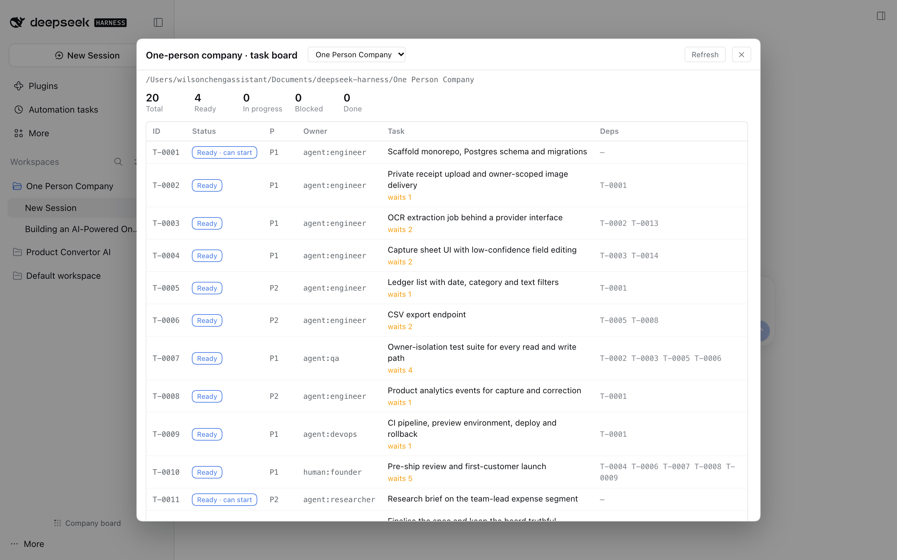
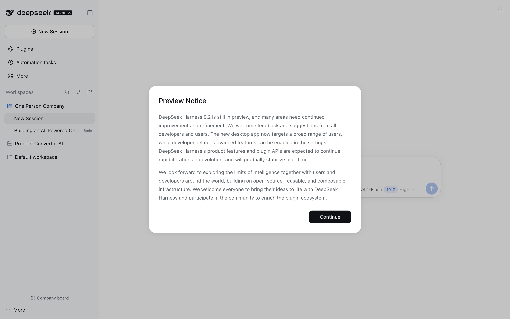

# dsh-one-person-company

Run a software company alone, with a team of AI agents.

This plugin installs an operating system for a one-person company: **ten role
charters**, a **spec-as-contract** workflow, a **task board that refuses to lie**,
and a CLI that assembles the exact prompt for each agent. Plus a sidebar panel
that shows the board without leaving the GUI.



## The idea in one line

```sh
node tooling/src/cli.mjs pack T-0003
```

That command prints **the prompt you give an agent**: the company charter, the
approved spec, the task, the role charter, the declared write scope, the
definition of done, and the operating rules — about 300 lines instead of the
whole repository.

Everything else in this system exists to make that one prompt trustworthy.

## Install

```sh
dsh plugin --profile web add dsh-one-person-company
```

Restart the host (`~/.dsh/restart-dsh-web.sh`) and refresh the page. Two things
appear:

1. **A `one-person-company` skill** in every workspace's catalog. Ask an agent
   *"use the one-person-company skill to start a project here"*.
2. **A "Company board" button** in the sidebar footer.

## Quick start

Bootstrap a workspace — this copies the reusable machine and generates a clean
per-project skeleton:

```sh
opc bootstrap ~/Projects/my-company
```

Or straight from the installed plugin, without the `opc` bin:

```sh
bash ~/.dsh/profiles/web/node_modules/dsh-one-person-company/bootstrap.sh ~/Projects/my-company
```

Then:

```sh
cd ~/Projects/my-company
$EDITOR company/charter.md          # the one thing a human must write
node tooling/src/cli.mjs new spec "Your first feature"
node tooling/src/cli.mjs new task "First slice" \
  --spec company/specs/<file>.md --owner agent:engineer --writes "apps/**"
node tooling/src/cli.mjs doctor     # ~30 consistency checks
node tooling/src/cli.mjs board --ready
```

## The five commands

| Command | When | What it does |
|---|---|---|
| `doctor` | first thing every session | tasks with no approved spec, acceptance criteria owned by nobody, owner roles with no charter, dependency cycles, empty verification commands, two runnable tasks writing the same path |
| `board` | to see state | every task with status, owner, priority, spec, dependencies |
| `board --ready` | to choose work | **only** tasks whose dependencies are done and whose spec is `approved` |
| `pack <ID>` | to start work | the prompt |
| `budget` | weekly | the spend ceilings from `company/budget.md` |

## What a workspace looks like

```
AGENTS.md                  operating manual for any agent
company/
  charter.md               what we do, for whom, what we will never do
  AGENTS.md                the eight operating rules
  specs/                   the contract: numbered AC-1..AC-n criteria
  tasks/                   the work ledger: T-0001.., status, owner, write scope
  decisions/               ADRs — why each costly decision was made
  research/                evidence with sources and dates
  metrics.md budget.md roadmap.md
.agent/
  roles/                   the ten role charters
  checklists/              definition of done, review, pre-ship
tooling/                   the opc CLI (no dependencies)
playbook/                  12 documents on how the machine works
```

### The ten roles

`researcher` · `pm` · `architect` · `designer` · `engineer` · `qa` · `devops` ·
`support` · `growth` · `reviewer`

Every role declares four things, and that is what makes it checkable rather than
decorative:

- **reads** — what context it needs (the context pack assembles it)
- **writes** — the paths it may change (the write scope)
- **never** — the lines it may not cross (the escalation rule)
- **done** — what "finished" means for it (the exit condition)

`reviewer` is the important one: it is read-only, its prompt says *assume the
work is wrong*, and its only output is approve / request changes / escalate.

## The loop

```
research → spec → design → implement → test → review → ship → operate → support → learn
```

One role per arrow, one artefact per stage, all in files under `company/`.

- **The spec is the contract.** No work starts before it is approved. `doctor`
  enforces it; `board --ready` will not show a task whose spec is a draft.
- **Write scopes are real.** Two runnable tasks writing the same path is
  reported as a bug, not a race.
- **Never claim what you did not verify.** Every task carries a `Verification`
  block with a runnable command. Measured: LLM judges detect an agent's false
  "done" at AUROC ≤ 0.65, while that failure is ~76% of self-assessed coding
  failures — so check the actual state, never ask a model.
- **Human gates.** Spending money, anything legally binding, anything
  irreversible in production, anything customer-facing, changing the charter or
  the definition of done, and the first launch — human only.

## The sidebar panel



Clicking **Company board** opens the task board for whichever registered
workspace carries a `company/` folder: summary counts, every task with its
status, priority, owner and dependencies, and which tasks are startable right
now (`Ready · can start`, or `waits 2`).

It reads the **same parser** the CLI uses — the host half imports
`template/tooling/src/board.mjs` — so the panel and `opc board` cannot disagree.
A workspace with no company OS yet gets a path and a copy button instead of an
error.

## Why it is built this way

- **Files, not a database.** Every artefact is markdown in the repo. That is
  what lets the company survive a harness change, a model change and a price
  change — all of which will happen.
- **Bounded context.** `pack` emits ~300 lines, not the whole repository.
  Context that grows with the project is the failure mode the research calls
  context rot.
- **The board is derived.** Status lives in task files; the board is computed.
  There is no tracker to fall out of sync.
- **Machines check the rules.** Every rule that *can* be checked by a machine is
  checked by `doctor`, because a rule that lives only in a prompt is context,
  not a control.

The `playbook/` in every bootstrapped workspace explains the reasoning, with
sources: why verification is the bottleneck, what the productivity research
actually says, what a solo founder's unit economics look like, and the honest
failure list.

## Bootstrap flags

```sh
bash bootstrap.sh /path/to/workspace     # create
bash bootstrap.sh /path/to/workspace --check   # dry run
bash bootstrap.sh /path/to/workspace --force   # overwrite an existing tooling/
```

The script never overwrites an existing `company/specs/`, `tasks/` or
`charter.md` — product state is always preserved.

## Known friction

- `new task` produces an intentionally incomplete task: `doctor` reports the
  missing verification command and the unowned acceptance criteria until you
  fill them in. That is the check working.
- A fresh workspace has two warnings — no tasks yet, and no direction sentence
  in `company/roadmap.md`. Both clear once real work starts.
- The demo product in `examples/` describes a product that lives in another
  repository, so its `pnpm` verification commands are illustrative. Only
  `node tooling/src/cli.mjs …` commands run inside the company workspace itself.

## Compatibility

DSH 0.2.x, web profile. Node ≥ 18. No runtime dependencies: the CLI is plain
ESM, and the plugin declares none.

## License

MIT.
