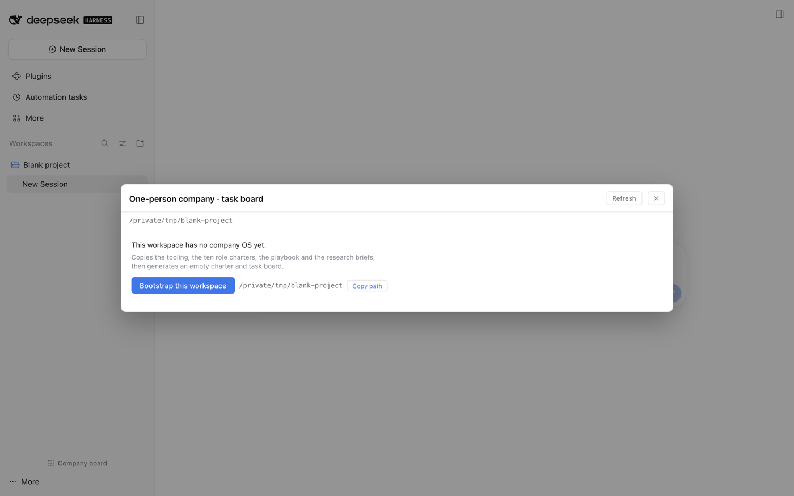
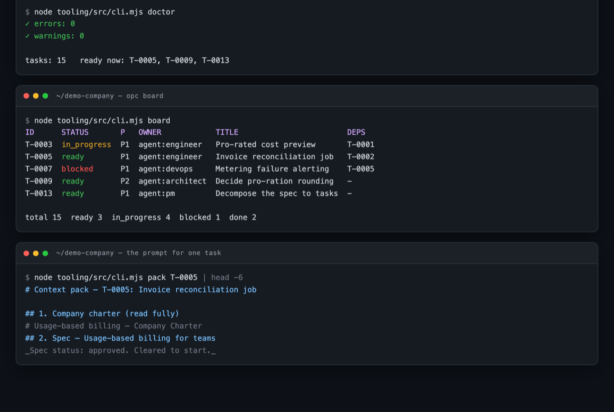

<p align="center">
  
</p>

<h1 align="center">dsh-one-person-company</h1>

<p align="center">
  Run a software company <strong>alone</strong>, with a team of AI agents.<br>
  Ten role charters · a spec-as-contract workflow · a task board that refuses to lie.
</p>

---

## The idea in one line

```sh
node tooling/src/cli.mjs pack T-0005
```

That command prints **the prompt you give an agent**: the company charter, the
approved spec, the task, the role charter, the declared write scope, the
definition of done, and the operating rules — about 300 lines instead of the
whole repository.

Everything else here exists to make that one prompt trustworthy. The plugin
ships the machine (the CLI, the playbook, the roles, the rules) plus a sidebar
panel that shows the board without leaving the GUI.

## Install

```sh
dsh plugin --profile web add dsh-one-person-company
```

Restart the host and refresh the page. Two things appear:

1. **A `one-person-company` skill** in every workspace's catalog — ask an agent
   *"use the one-person-company skill to start a project here"*.
2. **A "Company board" panel row** in the sidebar, beside *Plugins* and
   *Automation tasks*.

## Quick start — entirely inside the GUI

1. Add a workspace in DSH as you normally would. An empty folder is fine.
2. Open **Company board** — a panel row in the sidebar, beside *Plugins* and
   *Automation tasks*.
3. It reports *this workspace has no company OS yet* and offers **Bootstrap this
   workspace**. Click it.
4. The board appears. Ask an agent to write the charter and the first spec.

No terminal, no commands. The button runs the bundled `bootstrap.sh` on the host,
against the path the workspace registry already holds.

### Or from a terminal, if you prefer

```sh
opc bootstrap ~/Projects/my-company        # or: bash bootstrap.sh ~/Projects/my-company
cd ~/Projects/my-company

$EDITOR company/charter.md                 # the one thing a human must write
node tooling/src/cli.mjs new spec "Your first feature"
node tooling/src/cli.mjs new task "First slice" \
  --spec company/specs/<file>.md --owner agent:engineer --writes "apps/**"
node tooling/src/cli.mjs doctor            # ~30 consistency checks
node tooling/src/cli.mjs board --ready
```

## What you get

```
AGENTS.md                  operating manual any agent reads first
company/
  charter.md               what we do, for whom, what we will never do
  AGENTS.md                the eight operating rules
  specs/                   the contract: numbered AC-1..AC-n criteria
  tasks/                   the work ledger: status, owner, write scope, deps
  decisions/               ADRs — why each costly decision was made
  research/                4 source-linked research briefs
  metrics.md  budget.md  roadmap.md
  playbooks/               on-call, release, support answers
.agent/
  roles/                   the ten role charters
  checklists/              definition of done · review · pre-ship
tooling/                   the opc CLI — plain ESM, zero dependencies
docs/architecture/         four Mermaid diagrams: System, Backend, Frontend, Data
playbook/                  12 documents on how the machine works
```

## Screenshots

### The board


Summary counts, and every task with its status, priority, owner and
dependencies. `Ready · can start` marks tasks whose dependencies are done *and*
whose spec is approved; `waits 3` marks the ones that are not.

### Not a company workspace yet



A workspace with no `company/` folder is not an error — it is the one click
between you and a working company OS. The button runs the bootstrap on the host;
the path stays available for copying if you would rather run it yourself.

### The CLI



`doctor` is the health check, `board` is the derived view, `pack` is the prompt.

## The ten roles

| Role | Owns | Never |
|---|---|---|
| `researcher` | the research brief — every claim with a source and a date | state a fact without a source; edit specs or code |
| `pm` | the spec, the board, the roadmap | let a task become "ready" without an approved spec |
| `architect` | the ADR and the interfaces between parts | write implementation code |
| `designer` | the design system, the flows, the copy | invent a colour or spacing value outside the tokens |
| `engineer` | the code, inside its declared write scope | claim something works without running the command |
| `qa` | the failing test that proves a defect | delete or weaken a failing test |
| `devops` | the pipeline, the deploy, the runbook, the alert | deploy without a tested rollback |
| `support` | the answer, the knowledge-base article, bugs filed as tasks | promise a date, a price, or a refund |
| `growth` | the asset, the channel, the metric | send anything to a real person without approval |
| `reviewer` | one verdict: approve / request changes / escalate | fix the work itself |

Each charter declares four things — **reads**, **writes**, **never**, **done**.
That is what makes a role checkable rather than decorative. The `reviewer` is
the important one: read-only, told to *assume the work is wrong*.

## The architecture is an artefact, not a drawing

`docs/architecture/README.md` holds four Mermaid diagrams — **System** (what
talks to what), **Backend** (the request path and which module owns each step),
**Frontend** (screens and the endpoints they call), and **Data** (the tables and
their joins). They are text, so they diff in git, GitHub renders them, and an
agent reads the whole file in about 90 lines.

The rule that makes them worth having:

> **A diagram that does not match the code is worse than no diagram.**

So the diagram is not a one-off deliverable. Any task that adds or removes a
component, a table, a route or a third party updates it in the same change; the
`reviewer` role treats an unchanged diagram against a changed component as a
blocking finding.

Why not auto-generate it? Anything derived from code goes stale the moment the
code changes and nobody notices. An owned artefact with a reviewer gate stays
true; a generated picture lies quietly.

## The five commands

| Command | When | What it does |
|---|---|---|
| `doctor` | first thing every session | the checks below |
| `board` | to see state | every task with status, owner, priority, spec, deps |
| `board --ready` | to choose work | **only** tasks whose deps are done and whose spec is `approved` |
| `pack <ID>` | to start work | the prompt |
| `budget` | weekly | the spend ceilings from `company/budget.md` |

Also: `new spec · new task · new adr · new research · new incident ·
new release · roles · init`. `npm link` installs the `opc` shorthand.

## What `doctor` actually checks

Every rule that *can* be checked by a machine is checked here, because a rule
that lives only in a prompt is context, not a control.

| Check | Why it matters |
|---|---|
| A task is active but its spec is missing or still `draft` | the contract is not signed |
| An `AC-n` in a spec is owned by no task | the spec is quietly half-built |
| A task's owner role has no charter | that agent has no instructions |
| A task's status is not one of the seven | the task is invisible to the board |
| A dependency cycle exists | the board deadlocks |
| A `Verification` block is empty or only comments | "done" has no evidence |
| Two runnable tasks write the same path | two agents, one file, lost work |
| An `in_progress` task has no write scope | nobody knows what it may touch |
| A role owns no task | a role nobody is running |
| The roadmap has no direction sentence | the team has no steering input |
| A required file is missing | the machine is incomplete |

## How the panel works

- **Host half** (`lib/index.js`) registers a Typert Remote service `opcBoard`
  whose `list()` reads `company/tasks/*.md` out of **every registered
  workspace** and returns the parsed board. The Gateway auto-claims the
  endpoints, so there is no route, no permission, and no extra attack surface.
- **It imports the template's own parser** — `template/tooling/src/board.mjs` —
  so the panel and `opc board` can never disagree about what is ready.
- **Browser half** (`lib/client.js`) contributes two registrations, exactly the
  pair Plugins and Automation tasks use: a row in `sidebar.panellist` (its nav
  list, `order: 20`) and a page in `main` keyed by the same panel id. The board
  is therefore a normal panel — it selects, deep-links and survives a reload the
  way the built-in panels do, with no overlay or z-index of its own.
- **Bootstrap runs on the host, by workspace id.** The client never sends a
  path, so the button can only write into a folder already registered as a
  workspace. It refuses a workspace that already has `company/tasks`.
- **Paths are shown with `~` collapsed**, so the dialog can be screenshotted or
  screen-shared without carrying a user name around.

## Why files, not a database

- **Portable.** Every artefact is markdown in the repo. The company survives a
  harness change, a model change, and a price change — all of which will happen.
- **Bounded context.** `pack` emits ~300 lines, not the whole repository.
  Context that grows with the project is the failure mode the research calls
  *context rot*.
- **Derived board.** Status lives in the task files; the board is computed.
  There is no tracker to fall out of sync.
- **Reviewable.** A diff of the company's state is a diff of markdown.

## Compatibility

DSH 0.2.x, web profile for the panel. **The CLI works with no DSH at all** —
plain ESM, Node ≥ 18, zero runtime dependencies. The plugin declares none either.

## Bootstrap flags

```sh
bash bootstrap.sh /path/to/workspace            # create
bash bootstrap.sh /path/to/workspace --check    # dry run
bash bootstrap.sh /path/to/workspace --force    # overwrite an existing tooling/
```

The script **never overwrites** an existing `company/specs/`, `company/tasks/`
or `company/charter.md`. The machine is reusable; product state is not.

## FAQ

**Is this a project management tool?**
No. It is files plus a checker. There is no server, no account, no sync.

**Does it call an LLM anywhere?**
No. Zero API calls. It assembles context and checks invariants. The model is the
one you already have in the harness.

**Do I need DSH to use it?**
Only for the sidebar panel. The CLI and the workflow are plain files and Node.

**Will bootstrapping clobber my existing project?**
No. It copies `tooling/`, `playbook/`, `examples/`, `package.json` and
`.gitignore`, merges six reusable company files, and generates the rest only
where absent.

**How is this different from a TODO list?**
A task cannot be *ready* without an approved spec, and cannot be *done* without
a runnable verification command. A TODO list has neither gate.

**My agent ignores the board.**
Put `doctor` in CI. The CLI exits non-zero on an error, so the rule becomes
enforced rather than requested.

**Do I have to use all ten roles?**
No. Start with `engineer` + `reviewer` and add the rest when a role's artefact
actually goes missing. The charters cost nothing until used.

## Known friction

- `new task` produces an intentionally incomplete task: `doctor` reports the
  missing verification command and the unowned acceptance criteria until you
  fill them in. That is the check working, not a failure.
- A fresh workspace has two warnings — no tasks yet, and no direction sentence
  in `company/roadmap.md`. Both clear once real work starts.
- The demo product in `examples/` describes a product that lives in another
  repository, so its `pnpm` verification commands are illustrative. Only
  `node tooling/src/cli.mjs …` commands run inside the company workspace itself.

## Roadmap

- [x] Bootstrap a workspace from the GUI (0.2.0)
- [x] The board is a sidebar panel row, not a footer button (0.3.0)
- [ ] `doctor --json` for CI
- [ ] A task detail view in the panel (read a task body without a terminal)
- [ ] Run `doctor` from the panel and show a health badge
- [ ] `sync-template.sh` to keep an installed workspace's machine current
- [ ] Optional `reviewer` seat on a separate model, so the adversary is never
      the same model that wrote the work

## Crediting the research

`playbook/` is not opinion. It is written against four briefs with sources and
dates: the productivity research (including the study the authors later
retracted), what verification actually costs, the unit economics of a solo
company, and the honest failure list. They ship in every bootstrapped workspace
under `company/research/`.

## License

MIT.
