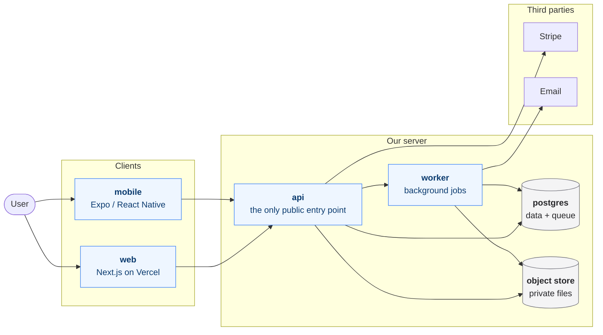
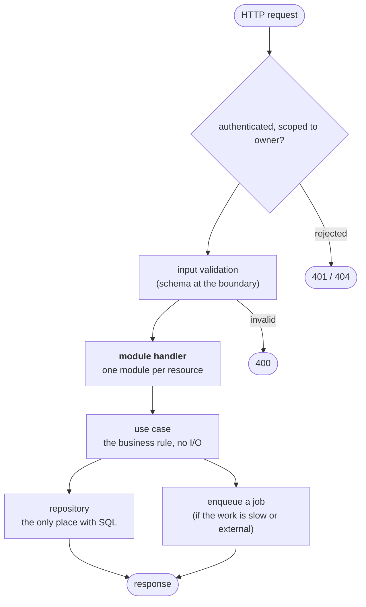
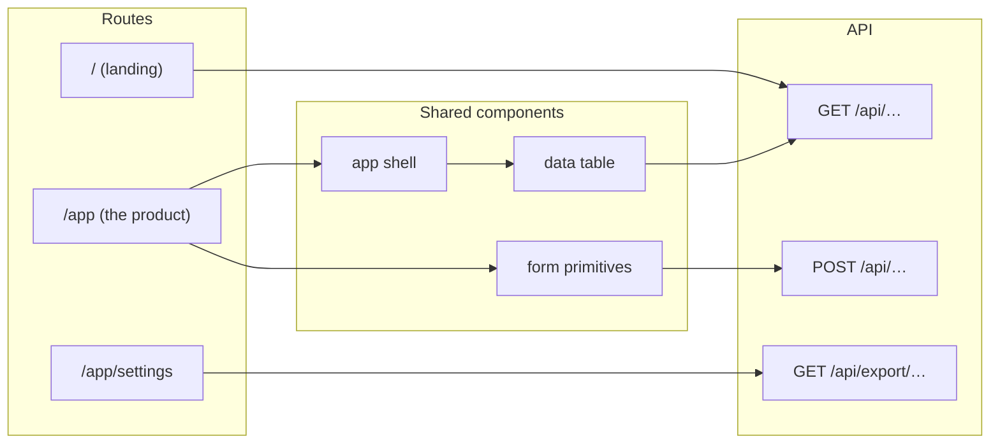
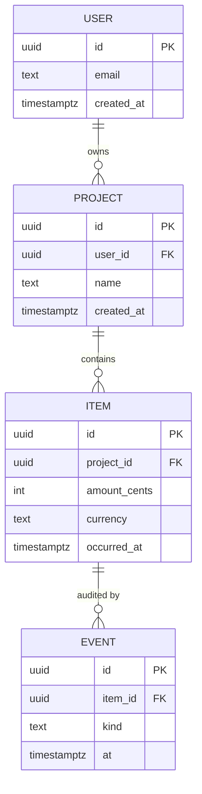

# Architecture

Four diagrams, in one file. They are **text**, on purpose: they diff in git,
GitHub renders them, and an agent can read the whole thing in about 90 lines
instead of reading the repository.

The point is that a human can answer *"did the system change shape?"* in 30
seconds. Prose and ADRs cannot give you that.

| Section | Answers |
|---|---|
| [System](#system) | What are the moving parts, and what talks to what? |
| [Backend](#backend) | What is the request path, and which module owns each step? |
| [Frontend](#frontend) | What screens exist, and which endpoint does each call? |
| [Data](#data) | What are the tables, and how are they joined? |

## The rules

1. **A diagram that does not match the code is worse than no diagram.** When a
   task adds or removes a component, a table, a route or a third party, the same
   task updates this file. It is part of the definition of done.
2. **These are not auto-generated.** Anything derived from code goes stale the
   moment the code changes and nobody notices. They are owned artefacts: the
   `architect` role writes them, the `reviewer` role checks them against the
   diff.
3. **One diagram per question.** If `## System` needs a legend to be read, it is
   two diagrams.
4. **Name the real things.** The names here are the names in the code and in the
   ADRs. `api`, not "The Application Layer".

## Reviewing a change

Open `## System`. Ask: did this change add a box, remove a box, or add an
arrow? If yes, this file had to change in the same commit. If it did not change
and the system's shape did, the change is not done.

## System

## Backend

What this shape enforces: authorisation is checked once at the boundary, not
sprinkled through handlers; a repository is the only thing that writes SQL;
anything slow or third-party becomes a job rather than an inline await.

## Frontend

What this shape enforces: every screen is assembled from shared components;
naming the endpoints per screen gives a backend change a visible blast radius.

## Data

What this shape enforces: every table has an owner column and row-level
security filters on it; money is integer minor units plus a currency, never a
float; anything a customer can lose has an audit table.
